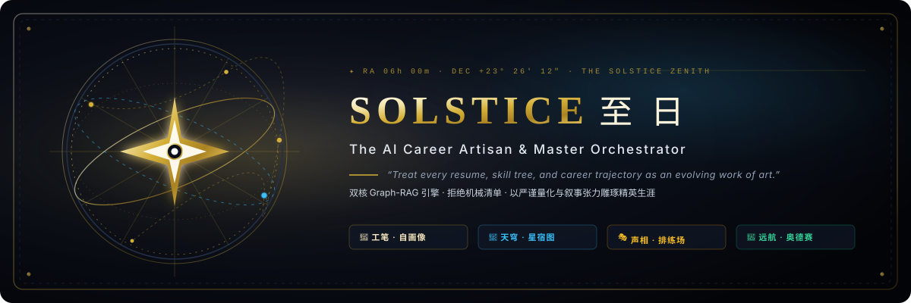
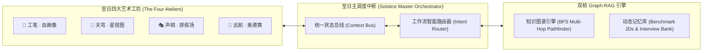

<div align="center">

  

  <br />

  <p align="center">
    <em>“每一份经历，皆是未完成的旷世长卷；每一簇星宿，皆是指向天顶的引力之弦。”</em>
  </p>

  <p align="center">
    
    
    
    
    
  </p>

  <p align="center">
    <a href="#-策展手记--画布原则-the-canvas-principle">策展哲学</a> •
    <a href="#-四联画--四大艺术工坊-the-four-ateliers">四联工坊</a> •
    <a href="#-双螺旋基座--图谱与记忆之翼">双核架构</a> •
    <a href="#-天象启动录-quick-start">启航指南</a> •
    <a href="#-工程拓扑与法度">工程法度</a>
  </p>

  

</div>

## ✦ 策展手记 · 画布原则 (The Canvas Principle)

在工业化 HR 算法以关键词冷酷裁决个体的时代，**Solstice (至日)** 选择重返文艺复兴工坊的初心：

* **经历非清单，乃是长卷 (Life as an Unfolding Canvas)**：简历不是冰冷勾选的 Checklist，而是随认知、技术与雄心持续生长的流动艺术品。
* **量化有风骨，叙事具统御 (Rigor Marries Narrative Artistry)**：拒绝无力的“参与/负责”，以 STAR 骨架为笔，将系统吞吐、p99 延迟与架构抉择点化为无可辩驳的统治力叙事。
* **以引力寻径，跨多跳天堑 (Chart the Constellation Across the Void)**：基于 **Graph-RAG** 深度知识图谱，不仅呈现匹配度，更能穿越迷雾，自动寻得通往 Google、OpenAI、Jane Street 的多跳技能天桥。

<div align="center">
  
</div>

## 🌌 四联画 · 四大艺术工坊 (The Four Ateliers)

### 🎨 卷壹 · 工笔自画像 (The Self-Portrait Atelier)
> *“于细微处雕琢锋芒，将平庸陈述炼化为金。”*

* **STAR 四维黄金解构**：穿透琐碎职责，提炼情境 (S)、任务 (T)、行动 (A) 与量化结果 (R) 的四柱承重视界；
* **动词能量重铸 (Verb Potency Index)**：实时识别并替换无力动词，注入顶级工程与管理语境的高势能行动词汇；
* **ATS 语义共振雷达**：动态逆向映射标杆岗位 JD，精准捕捉核心技术词汇的饱和度与待融入图元。

---

### 🌌 卷贰 · 天穹星宿图 (The Constellation Atelier)
> *“仰观星宿位移，推演能力跃迁的万有引力。”*

* **天体引力场交互星图**：金色星宿指涉已觉醒能力，青蓝坐标辉映名企必备能力，连线明灭即是图谱耦合；
* **多跳跃迁天桥 (Multi-Hop Pathfinder)**：基于 BFS 图算法推演最短学习轨迹（例：`Python` $\to$ `分布式共识` $\to$ `LLM 推理拓扑` $\to$ `CUDA 内核开发`）；
* **企业文化基因解构**：深度剖析 OpenAI 极客韧性、Google 学院风骨、Jane Street 贝叶斯谦逊与 Stripe 极致工匠精神。

---

### 🎭 卷叁 · 声相排练场 (The Rehearsal Atelier)
> *“舞台之上，唯有心智纪律与临场气场方能定乾坤。”*

* **四重名企面试官人设**：
  * **⚡ Dr. Vance (严苛架构负责人)**：直击底层高并发、GC 停顿、内存屏障与故障恢复拓扑；
  * **🧭 Elena Rostova (前瞻产品总监)**：审视第一性原理、用户共情与单位经济模型平衡；
  * **🤝 Sarah Jenkins (敏锐资深 HR)**：深挖文化契合度、团队冲突化解与心理安全感；
  * **📐 Nikolai Chen (量化策略总监)**：高压下瞬时期望值推导、条件概率与贝叶斯博弈。
* **导演剪辑版复盘 (Director's Cut Report)**：技术纵深、结构条理、量化严谨、领导力气场四维雷达评分，并附赠至日黄金解题示范 (Golden Exemplar)。

---

### 🧭 卷肆 · 远航奥德赛 (The Odyssey Atelier)
> *“运筹帷幄之中，于高维博弈中执掌主权。”*

* **生涯航向全周期看板**：机缘发现 $\to$ 定制重塑 $\to$ 面试攻坚 $\to$ 斩获 Offer $\to$ 战略博弈；
* **文化基因定向破局信**：为业务主管、极客同行或招聘负责人量身撰写极具专业共鸣的敲门砖信函；
* **主权艺术家薪酬博弈战略**：依据图谱共振优势输出针对高阶薪酬与股权的顶级谈判脚本。

<div align="center">
  
</div>

## ⚙️ 双螺旋基座 · 图谱与记忆之翼

```
                     ✦ SOLSTICE GRAPH-RAG CORE ✦
      
           【 知识图谱 (KG Engine) 】       【 动态记忆 (RAG Engine) 】
                  结构化骨骼                       血肉与语境
                      │                               │
             • 邻接图谱拓扑推演               • 向量语义余弦相似度
             • 多跳技能天桥寻径               • 顶级名企真题题库
             • 企业文化基因矩阵               • 高光 STAR 动词能量池
                      │                               │
                      └──────────────┬────────────────┘
                                     ▼
                     【 渐进式多模态推理自适应层 】
                       本地高保真引擎 ⇄ Gemini ⇄ GPT-4o
```



<div align="center">
  
</div>

## 🚀 天象启动录 (Quick Start)

三步点亮本地至日艺术工坊：

```bash
# 1. 探访至日殿堂
git clone https://github.com/Moon-Meld/Solstice.git
cd Solstice

# 2. 注入工程养分
npm install

# 3. 按需唤醒天穹界面 (开发运行)
npm run dev
```

> **渐进式运行说明**：系统内置高保真 Graph-RAG 知识图谱推理引擎，无需配置外部网络或 API 密钥即可直接享受完整的四工坊流转体验。若需接入万亿大模型实时推理，可在界面右上角罗盘设置中随时填入 Google Gemini 或 OpenAI API Key。

<div align="center">
  
</div>

## 📁 工程拓扑与法度

<details>
<summary><strong>✦ 展开品鉴工程法度与目录脉络 (Architecture Blueprint)</strong></summary>

```
Solstice/
├── assets/
│   ├── solstice-banner.svg         # 浑天仪天文志全景宽幅海报
│   └── solstice-divider.svg        # 极细流金星芒分割线规
├── public/
│   ├── solstice-logo.svg           # 至日八角天体主星矢量印章
│   └── favicon.svg                 # 浏览器精细标签图标
├── src/
│   ├── components/                 # 琉璃拟态与天穹微粒前端组件
│   │   ├── Navigation/             # 天体罗盘导航与星位切换
│   │   ├── SelfPortrait/           # 工笔自画像 Atelier (STAR 叙事工坊)
│   │   ├── Constellation/          # 天穹星宿图 Atelier (SVG 交互式引力场)
│   │   ├── TheRehearsal/           # 声相排练场 Atelier (四重人设面试舞台)
│   │   ├── Odyssey/                # 远航奥德赛 Atelier (求职看板与破局文书)
│   │   └── Common/                 # 天体星辰背景与模型配置弹窗
│   ├── services/                   # 核心计算与调度引擎
│   │   ├── kgEngine.ts             # 知识图谱算法引擎 (BFS 多跳寻径)
│   │   ├── ragEngine.ts            # 动态语义检索与 ATS 共振计算
│   │   ├── orchestrator.ts         # 至日统一总指挥编排器
│   │   ├── llmAdapter.ts           # 渐进式多模态推理适配器
│   │   └── agents/                 # 四大子智能体实现
│   ├── data/                       # 名企图谱、标杆 JD、真题库与动词模版
│   ├── types/                      # 严谨 TypeScript 类型声明
│   ├── App.tsx                     # 根舞台组件
│   └── index.css                   # 琉璃拟态与金芒质感样式
├── .github/workflows/ci.yml        # GitHub Actions 自动化持续集成
├── CONTRIBUTING.md                 # 工匠级开源贡献守则
├── LICENSE                         # MIT 开源协议
└── package.json
```

</details>

---

## 📜 许可证 (License)

本项目遵循 [MIT License](LICENSE) 开源协议。

<div align="center">
  <br />
  
  <br />
  <sub>Artisan-crafted with pure devotion by the Solstice Architecture Guild.</sub>
  <br />
  <sub>“至日之光，普照万方。”</sub>
</div>
