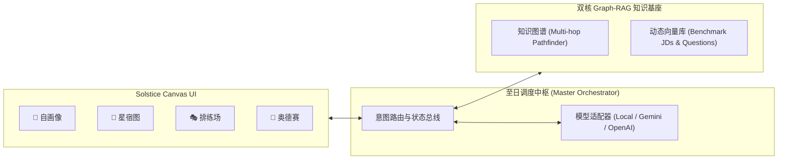

<div align="center">

  

  <br />

  [](https://www.typescriptlang.org/)
  [](https://react.dev/)
  [](https://tailwindcss.com/)
  [](https://vitejs.dev/)
  [](https://github.com/Moon-Meld/Solstice)
  [](LICENSE)

  <br />

  <p align="center">
    <strong>🌌 专为精英实习与名企求职打造的 AI 职业生涯艺术工坊与总指挥官</strong>
    <br />
    <em>拒绝冰冷的关键词堆砌，将每一段经历炼化为具备严谨量化支点与统御力的叙事杰作。</em>
  </p>

  <p align="center">
    <a href="#-四大艺术工坊-the-four-ateliers">工坊特性</a> •
    <a href="#-双核-graph-rag-引擎">双核引擎</a> •
    <a href="#-系统架构">系统架构</a> •
    <a href="#-快速上手">快速上手</a> •
    <a href="#-目录与工程设计">目录设计</a>
  </p>

</div>

---

> ### ✦ The Canvas Principle (画布原则)
> 每一份简历、每一条技能树与职业航向，皆为持续生长的艺术品，而非机械打勾的清单。我们融合 **知识图谱 (KG)** 的多跳拓扑推理与 **动态检索增强 (RAG)** 的语境记忆，赋予求职者从简历打磨、技能跃迁到面试博弈的全周期主权。

---

## 🌌 四大艺术工坊 (The Four Ateliers)

| 工坊 | 核心定位 | 核心能力 |
| :--- | :--- | :--- |
| **🎨 自画像**<br><sub>Self-Portrait</sub> | **简历重构与叙事艺术** | • **STAR 黄金重塑**：提炼情境、任务、行动与量化战果，消除平淡被动动词<br>• **动词能量指数**：评估动作动词统治力并自动注入高潜专业词汇<br>• **ATS 语义共振**：实时比对目标职位标杆 JD，雷达透视核心词捕获度 |
| **🌌 星宿图**<br><sub>Constellation</sub> | **技能图谱与多跳对齐** | • **天体引力场星图**：交互式点亮技能星宿、目标岗位必备星宿与跃迁星轨<br>• **多跳跃迁天桥**：基于 BFS 算法推理跨技能成长路线（如 `Python` $\to$ `分布式共识` $\to$ `CUDA 内核`）<br>• **文化基因拓扑**：解构 OpenAI、Google、Jane Street、Stripe 等底层考核基因 |
| **🎭 排练场**<br><sub>The Rehearsal</sub> | **沉浸式模拟面试** | • **四重名企人设**：严苛架构负责人、前瞻产品总监、资深敏锐 HR、量化策略总监<br>• **高频动态攻防**：递进式追问、实时评测分与至日战术锦囊提示抽屉<br>• **导演剪辑版复盘**：技术纵深、结构条理、量化严谨、气场四维评分与典范范文 |
| **🧭 奥德赛**<br><sub>Odyssey</sub> | **生涯航道与战略副驾** | • **全周期看板**：追踪发现、定制重塑、推进面试、斩获 Offer 到战略博弈全阶段<br>• **文化定向破局信**：针对业务主管、核心极客或招聘官定制专属破局邮件<br>• **主权薪酬谈判**：依据图谱共振优势输出针对高阶薪酬的反向博弈话术 |

---

## ⚙️ 双核 Graph-RAG 引擎

```
┌────────────────────────────────────────────────────────┐
│                   SOLSTICE DUAL-ENGINE                 │
├──────────────────────────┬─────────────────────────────┤
│   知识图谱引擎 (KG Engine)   │   动态语义记忆 (RAG Engine)    │
├──────────────────────────┼─────────────────────────────┤
│ • 邻接图拓扑与多跳 BFS 寻径    │ • 词项与向量余弦相似度检索     │
│ • 名企岗位能力耦合权重与文化对齐 │ • 标杆企业历年真实面试题库     │
│ • 技能差距桥梁与学习周期预估   │ • 顶级科技/金融高张力动词库    │
└──────────────────────────┴─────────────────────────────┘
                             ▲
                             │
     ┌───────────────────────┴───────────────────────┐
     │ 渐进式多模态推理层 (Dual-Engine LLM Adapter)  │
     │   本地高保真模拟引擎 ⇄ Gemini 2.0 ⇄ GPT-4o   │
     └───────────────────────────────────────────────┘
```

---

## 🏛️ 系统架构



---

## 🚀 快速上手 (Quick Start)

三步开启 Solstice 艺术工坊：

```bash
# 1. 克隆代码库
git clone https://github.com/Moon-Meld/Solstice.git
cd Solstice

# 2. 安装工程依赖
npm install

# 3. 启动本地开发服务 (支持按需开启)
npm run dev
```

*默认启用内置的渐进式高保真 Graph-RAG 引擎（完全离线即开即跑），亦可在界面右上角一键填入 Google Gemini 或 OpenAI API Key 升级云端大模型协同。*

---

## 📁 目录与工程设计

<details>
<summary><strong>展开查看详细工程目录结构 (Directory Tree)</strong></summary>

```
Solstice/
├── assets/
│   └── solstice-banner.svg         # 极简居中艺术级全景海报
├── public/
│   ├── solstice-logo.svg           # 至日浑天仪高精度矢量印章
│   └── favicon.svg                 # 浏览器精细标签图标
├── src/
│   ├── components/                 # 现代化玻璃拟态与天穹星图 UI 组件
│   │   ├── Navigation/             # 天体罗盘导航栏
│   │   ├── SelfPortrait/           # 自画像 Atelier (STAR 叙事工坊)
│   │   ├── Constellation/          # 星宿图 Atelier (SVG 交互式引力场)
│   │   ├── TheRehearsal/           # 排练场 Atelier (四重人设面试舞台)
│   │   ├── Odyssey/                # 奥德赛 Atelier (求职看板与文书)
│   │   └── Common/                 # 背景粒子画布与模型配置弹窗
│   ├── services/                   # 核心计算与调度引擎
│   │   ├── kgEngine.ts             # 知识图谱算法引擎 (BFS 寻径)
│   │   ├── ragEngine.ts            # 动态语义检索与 ATS 共振计算
│   │   ├── orchestrator.ts         # 至日统一编排器
│   │   ├── llmAdapter.ts           # 渐进式模型适配器
│   │   └── agents/                 # 四大子智能体业务逻辑
│   ├── data/                       # 行业图谱、标杆 JD、名企真题与动词模板
│   ├── types/                      # 严谨 TypeScript 类型定义
│   ├── App.tsx                     # 根组件
│   └── index.css                   # 琉璃拟态与金芒质感样式
├── .github/workflows/ci.yml        # GitHub Actions 自动化持续集成
├── CONTRIBUTING.md                 # 艺术级贡献指南
├── LICENSE                         # MIT 开源协议
└── package.json
```

</details>

---

## 📜 开源协议

本项目基于 [MIT License](LICENSE) 协议开源。

<div align="center">
  <sub>Artisan-crafted with precision by the Solstice Architecture Guild.</sub>
</div>
