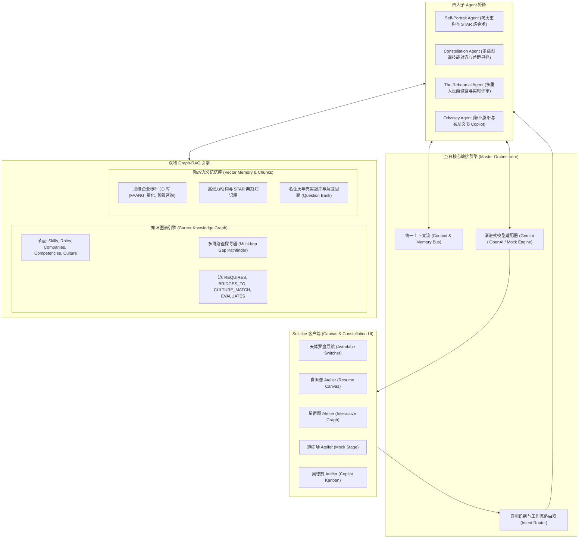

<div align="center">

  

  <br />
  <br />

  [](https://www.typescriptlang.org/)
  [](https://react.dev/)
  [](https://tailwindcss.com/)
  [](https://vitejs.dev/)
  [](https://github.com/Moon-Meld/Solstice)
  [](LICENSE)

  <p align="center">
    <strong>🌌 专为顶级名企求职与精英实习打造的 AI 职业生涯艺术工坊与总指挥官</strong>
    <br />
    <em>"The Canvas Principle"：每一份简历、每一条技能树与职业航向，皆为持续生长的艺术品，而非机械打勾的清单。</em>
  </p>

  <p align="center">
    <a href="#-系统架构图">系统架构</a> •
    <a href="#-四大艺术工坊-the-four-ateliers">四大工坊</a> •
    <a href="#-双核引擎机制">双核引擎</a> •
    <a href="#-快速上手">快速上手</a> •
    <a href="#-工程目录结构">工程目录</a>
  </p>

</div>

---

## ✦ 核心哲学：The Canvas Principle (画布原则)

在 **Solstice (至日)** 的世界里，求职不是机械匹配关键词的算力比赛，而是候选人与顶尖企业之间的**叙事共振**与**价值重合**：

* **拒绝冰冷清单**：我们将技能拓扑与经历映射至天穹星图，让优势如星辰般耀眼，让差距化作清晰可循的跃迁天桥。
* **双核智能驱动**：**Graph-RAG** 融合结构化知识图谱（KG）的多跳推演与动态向量记忆（RAG）的精准溯源。
* **艺术级人机交互**：采用文艺复兴浑天仪与深邃天穹色系（Obsidian Night & Solstice Gold），带来沉浸式的求职策展体验。

---

## 🏛️ 系统架构图



---

## 🌌 四大艺术工坊 (The Four Ateliers)

### 1. 🎨 自画像 (Self-Portrait · 履历重构与叙事艺术)
* **STAR 叙事黄金重塑**：精准提炼情境 (S)、任务 (T)、行动 (A)、结果 (R) 四维逻辑，将平铺直叙的职责转化为具备量化支点的硬核战绩；
* **动词能量指数 (Action Verb Potency Meter)**：自动剔除弱动词，替换为具有统御力的高潜动词（如 `Orchestrated`, `Decoupled`, `Spearheaded`）；
* **ATS 语义共振雷达**：动态检索标杆 JD 关键词，实时呈现匹配捕获度与高价值待融入词汇。

### 2. 🌌 星宿图 (Constellation · 岗位匹配与技能图谱)
* **天体引力场力导向可视化**：交互式点亮候选人已有技能星宿、目标岗位必备星宿与待点亮坐标；
* **多跳技能差距寻径 (Multi-Hop Skill Bridges)**：利用 BFS 算法在技能拓扑中计算最优学习迁移路径（如：`Python` $\to$ `分布式共识` $\to$ `LLM 推理架构` $\to$ `CUDA 内核`）；
* **动态调节点亮**：点击任意星宿即时重算全图引力场对齐分，并显示名企文化基因拓扑。

### 3. 🎭 排练场 (The Rehearsal · 沉浸式模拟面试)
* **四大企业级面试官人设**：
  * **⚡ Dr. Vance (严苛架构负责人)**：直击底层并发、GC 停顿、内存屏障与故障恢复；
  * **🧭 Elena Rostova (前瞻产品总监)**：深挖第一性原理、用户共情与单位经济收益；
  * **🤝 Sarah Jenkins (敏锐资深 HR)**：审视文化契合、团队冲突调解与心理安全感；
  * **📐 Nikolai Chen (量化策略总监)**：瞬时期望值推导、条件概率与贝叶斯思维。
* **导演剪辑版复盘报告 (Director's Cut Report)**：提供技术纵深、结构条理、量化严谨、领导力气场四维雷达评分，并附带至日典范级答题范文 (Golden Exemplar)。

### 4. 🧭 奥德赛 (Odyssey · 求职生涯航向与战略副驾)
* **全生命周期航道看板 (Kanban)**：发现机缘 $\to$ 定制重塑 $\to$ 推进面试 $\to$ 斩获 Offer $\to$ 战略博弈；
* **文化基因定向破局信 (Cultural Outreach Composer)**：针对业务主管、极客同行或招聘官生成量身定制的破局邮件；
* **主权艺术家薪酬博弈战略**：依据图谱共振优势输出高阶反向薪酬谈判方案。

---

## ⚙️ 双核引擎机制 (Dual-Engine Architecture)

| 核心组件 | 技术实现 | 业务价值 |
| :--- | :--- | :--- |
| **知识图谱 (KG)** | 邻接拓扑、BFS 最短路径寻径、权重耦合评估 | 突破单点匹配，发现前沿技能跃迁天桥与名企基因密码 |
| **向量记忆 (RAG)** | 词项余弦相似度检索、高密度关键词提取 | 实时索引名企高难度题库、顶级职位 JD 与 STAR 金句 |
| **渐进式模型适配** | 离线高保真合成引擎 + Gemini / OpenAI API 扩展 | 零配置即开即用，输入 Key 即可无缝升级万亿参数推理 |

---

## 🚀 快速上手 (Quick Start)

### 1. 克隆仓库与依赖就绪
```bash
git clone https://github.com/Moon-Meld/Solstice.git
cd Solstice
npm install
```

### 2. 启动至日艺术工坊
```bash
npm run dev
```
在浏览器打开 **`http://localhost:5173`** 即可开启沉浸式体验。

### 3. 构建生产级产物
```bash
npm run build
```

---

## 📁 工程目录结构

```
Solstice/
├── assets/
│   └── solstice-banner.svg         # 仓库艺术级宽幅全景海报
├── public/
│   ├── solstice-logo.svg           # 至日浑天仪高精度矢量印章
│   └── favicon.svg                 # 浏览器精细标签图标
├── src/
│   ├── components/
│   │   ├── Common/                 # 天体星辰背景与模型配置弹窗
│   │   ├── Navigation/             # 天体罗盘导航栏与星位切换
│   │   ├── SelfPortrait/           # 自画像 Atelier
│   │   ├── Constellation/          # 星宿图 Atelier
│   │   ├── TheRehearsal/           # 排练场 Atelier
│   │   └── Odyssey/                # 奥德赛 Atelier
│   ├── services/
│   │   ├── kgEngine.ts             # 知识图谱核心引擎
│   │   ├── ragEngine.ts            # 动态上下文向量检索引擎
│   │   ├── orchestrator.ts         # 至日总指挥编排器
│   │   ├── llmAdapter.ts           # 大模型与本地合成适配器
│   │   └── agents/                 # 四大子智能体实现
│   ├── data/                       # 预置图谱、题库、标杆 JD 与 STAR 模板
│   ├── types/                      # 严谨 TypeScript 类型声明
│   ├── App.tsx                     # 顶层入口组件
│   └── index.css                   # 琉璃拟态与金芒质感样式
├── .github/workflows/ci.yml        # GitHub Actions 自动化 CI 流程
├── CONTRIBUTING.md                 # 贡献指南
├── LICENSE                         # MIT 开源许可证
└── package.json
```

---

## 📜 许可证 (License)

本项目采用 [MIT License](LICENSE) 开源协议。

<div align="center">
  <sub>Artisan-crafted with precision by the Solstice Architecture Guild.</sub>
</div>
